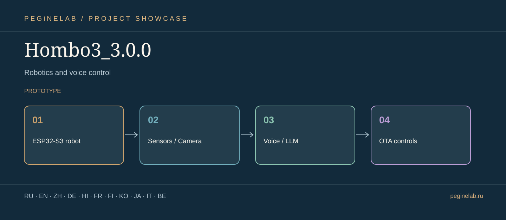

# Hombo3_3.0.0 · Visual project presentation

**Робототехника и голосовое управление / Robotics and voice control** · ESP32-S3 robot → Sensors / Camera → Voice / LLM → OTA controls · **prototype**.

**Translation scope:** the eleven languages below apply to this project overview; they do not claim that the running program or all documentation has eleven languages.

### Русский · ru
Управление ESP32-S3-роботом: камера, сенсоры, голос и OTA.. **Hombo3_3.0.0**: ESP32-S3 robot → Sensors / Camera → Voice / LLM → OTA controls.

### English · en
ESP32-S3 robot controls: camera, sensors, voice and OTA.. **Hombo3_3.0.0**: ESP32-S3 robot → Sensors / Camera → Voice / LLM → OTA controls.

### 简体中文 · zh
ESP32-S3 机器人控制：摄像头、传感器、语音与 OTA。. **Hombo3_3.0.0**: ESP32-S3 robot → Sensors / Camera → Voice / LLM → OTA controls.

### Deutsch · de
ESP32-S3-Robotersteuerung mit Kamera, Sensoren, Sprache und OTA.. **Hombo3_3.0.0**: ESP32-S3 robot → Sensors / Camera → Voice / LLM → OTA controls.

### हिन्दी · hi
ESP32-S3 रोबोट नियंत्रण: कैमरा, सेंसर, आवाज़ और OTA।. **Hombo3_3.0.0**: ESP32-S3 robot → Sensors / Camera → Voice / LLM → OTA controls.

### Français · fr
Commande d'un robot ESP32-S3 : caméra, capteurs, voix et OTA.. **Hombo3_3.0.0**: ESP32-S3 robot → Sensors / Camera → Voice / LLM → OTA controls.

### Suomi · fi
ESP32-S3-robotin ohjaus: kamera, anturit, puhe ja OTA.. **Hombo3_3.0.0**: ESP32-S3 robot → Sensors / Camera → Voice / LLM → OTA controls.

### 한국어 · ko
ESP32-S3 로봇 제어: 카메라, 센서, 음성 및 OTA.. **Hombo3_3.0.0**: ESP32-S3 robot → Sensors / Camera → Voice / LLM → OTA controls.

### 日本語 · ja
ロボット工学と音声制御. **Hombo3_3.0.0**: ESP32-S3 robot → Sensors / Camera → Voice / LLM → OTA controls.

### Italiano · it
Robotica e controllo vocale. **Hombo3_3.0.0**: ESP32-S3 robot → Sensors / Camera → Voice / LLM → OTA controls.

### Беларуская · be
Робататэхніка і галасавое кіраванне. **Hombo3_3.0.0**: ESP32-S3 robot → Sensors / Camera → Voice / LLM → OTA controls.

## Contacts · Контакты

- Telegram: [@Feudorlab1](https://t.me/Feudorlab1)
- E-mails: [feudor.lab@yandex.ru](mailto:feudor.lab@yandex.ru) · [obzorniky@gmail.com](mailto:obzorniky@gmail.com)
- [peginelab.ru](https://peginelab.ru/) · [GitHub project](https://github.com/musikfed/Hombo3_3.0.0)

*Actual operating status, test results and limitations must be checked in the source repository README.*
